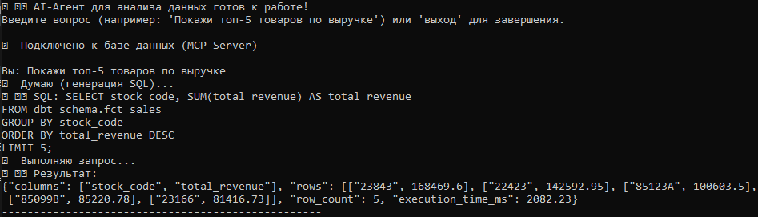
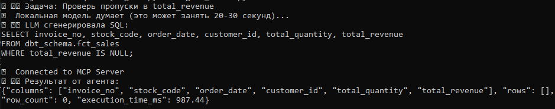
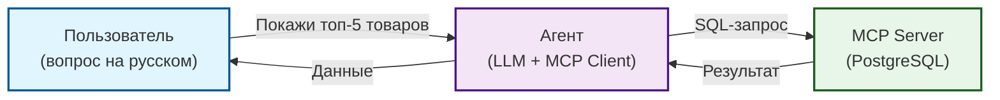

# 🤖 AI-агент для анализа данных (MCP)

Pet-проект: AI-агент, который принимает задачу на естественном языке (например, «Покажи топ-5 товаров по выручке»), генерирует SQL-запрос и выполняет его в PostgreSQL через **MCP (Model Context Protocol)**. Демонстрирует интеграцию LLM с пайплайнами данных и локальный запуск без API-ключей.

## 📸 Скриншоты

**1. Чат-бот: вопрос на русском → SQL → данные:**


**2. Проверка пропусков (локальная модель Qwen):**


## 🎯 Зачем это

В 2026 году агентные архитектуры (AI-агенты) становятся стандартом для автоматизации рутинных задач. Этот проект показывает, как с помощью **MCP** подключить LLM к базе данных, чтобы она могла самостоятельно выполнять аналитические запросы без участия человека. 

Проект работает в двух режимах:
- **Облачный** (заглушка/API) — для демонстрации логики.
- **Локальный** (Ollama + Qwen) — полностью автономный, без интернета и ключей.

## 🏗 Архитектура



## 📂 Структура

```
data-quality-agent/
├── run_server.py      # Обертка для запуска MCP-сервера (Windows fix)
├── client.py          # Простой клиент для проверки MCP
├── agent_mock.py      # Агент с заглушкой LLM (работает без API)
├── agent_local.py     # Агент с локальной моделью Qwen (Ollama)
├── agent_chat.py      # Чат-бот (цикл вопросов) с локальной моделью
├── assets/            # Скриншоты
├── README.md
└── requirements.txt
```

## 🚀 Запуск

### 1. Установи зависимости
```bash
pip install -r requirements.txt
```

### 2. Настрой подключение к БД
Создайте файл `.env` на основе `.env.example` и укажите свои реальные данные для подключения к БД.

### 3. Запуск с локальной моделью (рекомендуется)
Этот режим не требует API-ключей и работает полностью автономно:
```bash
# Установите Ollama (https://ollama.com/)
# Скачайте модель
ollama pull qwen2.5-coder:7b

# Запустите чат-бота
python agent_chat.py
```

**Пример работы чат-бота:**
```
Вы: Покажи топ-5 товаров по выручке
⏳ Думаю (генерация SQL)...
📝 SQL: SELECT stock_code, SUM(total_revenue) AS total_revenue
FROM dbt_schema.fct_sales
GROUP BY stock_code
ORDER BY total_revenue DESC
LIMIT 5;

📊 Результат:
{"columns": ["stock_code", "total_revenue"], "rows": [["23843", 168469.6], ["22423", 142592.95], ...], "row_count": 5, "execution_time_ms": 2082.23}
```

### 4. Запуск с заглушкой (без LLM)
Если нет ни API, ни Ollama:
```bash
python agent_mock.py
```

**Пример вывода:**
```
📝 Задача: Проверь пропуски в total_revenue
🤖 LLM сгенерировала SQL:
SELECT COUNT(*) AS total_rows, COUNT(*) FILTER (WHERE total_revenue IS NULL) AS null_rows FROM dbt_schema.fct_sales;

✅ Connected to MCP Server
📊 Результат от агента:
{"columns": ["total_rows", "null_rows"], "rows": [[387875, 0]], "row_count": 1, "execution_time_ms": 240.73}
```

## 💬 Примеры вопросов к агенту

- «Покажи топ-5 товаров по выручке»
- «Сколько всего уникальных клиентов?»
- «Какая средняя выручка за день?»
- «Найди отрицательную выручку, если есть»

## 🔮 Что дальше

Проект можно расширить:
- Добавить **Telegram-бота** (чтобы задавать вопросы с телефона).
- Подключить **второй MCP-сервер** (например, для работы с файлами или API).
- Настроить **автоматическую проверку качества** (алерты в Telegram при нахождении аномалий).

## 🔗 Связанные проекты

- [`data-governance-platform`](https://github.com/nconichtchenko-arch/data-governance-platform) — Data Governance (Каталог, Контракты, Lineage).
- [`soda-data-quality-demo`](https://github.com/nconichtchenko-arch/soda-data-quality-demo) — Data Quality проверки.
- [`api-data-contracts`](https://github.com/nconichtchenko-arch/api-data-contracts) — Data Contracts для API.

## 📫 Контакты

- **GitHub:** [github.com/nconichtchenko-arch](https://github.com/nconichtchenko-arch)
- **Email:** pavloni@mail.ru
- **Формат работы:** удалённо
