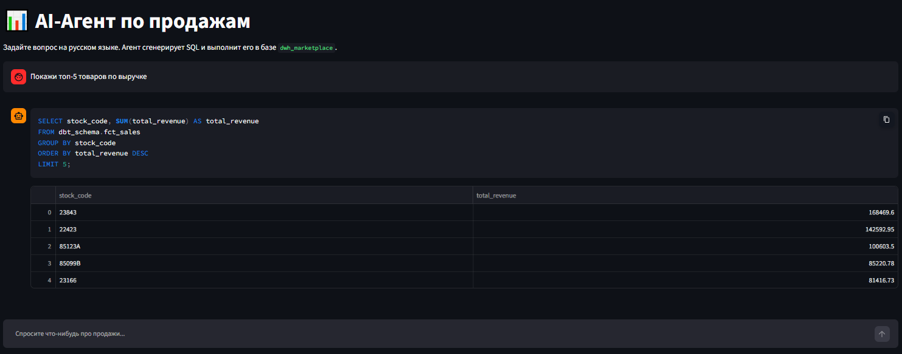
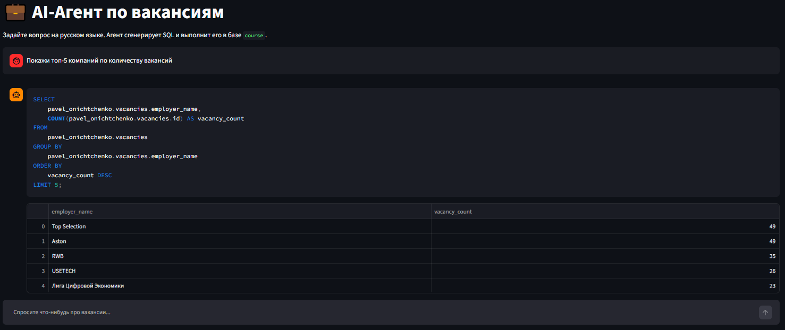
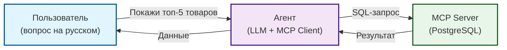

# 🤖 Мульти-базовый AI-агент для анализа данных (MCP)

Pet-проект: AI-агент, который принимает задачу на естественном языке (например, «Покажи топ-5 товаров по выручке»), генерирует SQL-запрос и выполняет его в PostgreSQL через **MCP (Model Context Protocol)**. 

**Главная особенность:** агент умеет работать с **двумя разными базами данных** одновременно:
1. `dwh_marketplace` — аналитика продаж (таблица `fct_sales`).
2. `course` — анализ вакансий и откликов (таблицы `vacancies`, `applications`).

Проект демонстрирует интеграцию локальной LLM (Ollama + Qwen) с пайплайнами данных без API-ключей.

## 📸 Скриншоты

**1. Веб-интерфейс для агента по продажам (Streamlit):**



**2. Веб-интерфейс для агента по вакансиям (Streamlit):**



**3. Консольный режим (для истории):**


## 🎯 Зачем это

В 2026 году агентные архитектуры (AI-агенты) становятся стандартом для автоматизации рутинных задач. Этот проект показывает, как с помощью **MCP** подключить LLM к базе данных, чтобы она могла самостоятельно выполнять аналитические запросы без участия человека. 

Проект работает в двух режимах:
- **Облачный** (заглушка/API) — для демонстрации логики.
- **Локальный** (Ollama + Qwen) — полностью автономный, без интернета и ключей.

## 🏗 Архитектура



## 📂 Структура

```
data-quality-agent/
├── run_server.py           # MCP-сервер для dwh_marketplace
├── run_server_course.py    # MCP-сервер для course
├── client.py               # Проверка подключения к dwh_marketplace
├── client_course.py        # Проверка подключения к course
├── agent_mock.py           # Агент с заглушкой LLM (работает без API)
├── agent_local.py          # Агент с локальной моделью Qwen (Ollama)
├── agent_chat.py           # Чат-бот для dwh_marketplace (консоль)
├── agent_chat_jobs.py      # Чат-бот для course (консоль)
├── app_chat_sales.py       # Streamlit-интерфейс для dwh_marketplace
├── app_chat.py             # Streamlit-интерфейс для course
├── assets/                 # Скриншоты
├── README.md
└── requirements.txt
```

## 🚀 Запуск

### 1. Установи зависимости
```bash
pip install -r requirements.txt
```

### 2. Настрой подключение к БД
Создайте файлы `.env` (для dwh_marketplace) и `.env.course` (для course) на основе `.env.example` и укажите свои реальные данные.

### 3. Запуск с локальной моделью (рекомендуется)
Этот режим не требует API-ключей и работает полностью автономно:
```bash
# Установите Ollama (https://ollama.com/)
# Скачайте модель
ollama pull qwen2.5-coder:7b

# Запустите веб-интерфейс для продаж
streamlit run app_chat_sales.py

# Или веб-интерфейс для вакансий
streamlit run app_chat.py
```

Откройте `http://localhost:8501` (или `8502`) и задавайте вопросы в чате.

### 4. Консольный режим (альтернатива)
Если не нужен браузер, можно запустить агентов в консоли:
```bash
python agent_chat.py
python agent_chat_jobs.py
```

## 💬 Примеры вопросов к агенту

**Для аналитики продаж (`app_chat_sales.py`):**
- «Покажи топ-5 товаров по выручке»
- «Сколько всего уникальных клиентов?»
- «Какая средняя выручка за день?»

**Для базы вакансий (`app_chat.py`):**
- «Сколько всего вакансий?»
- «Сколько вакансий в статусе sent?»
- «Покажи топ-5 компаний по количеству вакансий»

## 🔮 Что дальше

Проект можно расширить:
- Добавить **Telegram-бота** (отложено из-за блокировок).
- Подключить **третий MCP-сервер** (например, для работы с API HeadHunter).
- Настроить **автоматическую проверку качества** (алерты при нахождении аномалий).

## 🔗 Связанные проекты

- [`data-governance-platform`](https://github.com/nconichtchenko-arch/data-governance-platform) — Data Governance (Каталог, Контракты, Lineage).
- [`soda-data-quality-demo`](https://github.com/nconichtchenko-arch/soda-data-quality-demo) — Data Quality проверки.
- [`api-data-contracts`](https://github.com/nconichtchenko-arch/api-data-contracts) — Data Contracts для API.

## 📫 Контакты

- **GitHub:** [github.com/nconichtchenko-arch](https://github.com/nconichtchenko-arch)
- **Email:** pavloni@mail.ru
- **Формат работы:** удалённо
