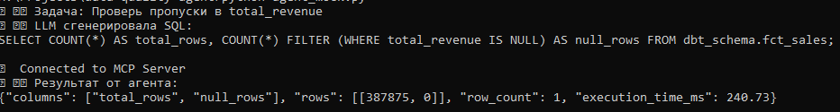
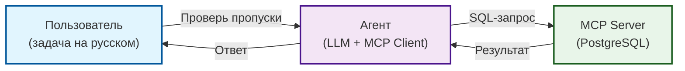

# 🤖 AI-агент для проверки качества данных (MCP)

Pet-проект: AI-агент, который принимает задачу на естественном языке (например, «Проверь пропуски в total_revenue»), генерирует SQL-запрос и выполняет его в PostgreSQL через **MCP (Model Context Protocol)**. Демонстрирует интеграцию LLM с пайплайнами данных.

## 📸 Скриншоты

**1. Работа агента с облачной LLM (заглушка):**



**2. Работа агента с локальной моделью Qwen (Ollama):**


## 🎯 Зачем это

В 2026 году агентные архитектуры (AI-агенты) становятся стандартом для автоматизации рутинных задач. Этот проект показывает, как с помощью **MCP** подключить LLM к базе данных, чтобы она могла самостоятельно проверять качество данных (искать пропуски, дубли, аномалии) без участия человека.

## 🏗 Архитектура



## 📂 Структура

```
data-quality-agent/
├── run_server.py      # Обертка для запуска MCP-сервера (Windows fix)
├── client.py          # Простой клиент для проверки MCP
├── agent_mock.py      # Агент с заглушкой LLM (работает без API)
├── assets/
│   └── agent_workflow.png  # Скриншот работы
├── README.md
└── requirements.txt
```

## 🚀 Запуск

1. Установи зависимости:
```bash
pip install -r requirements.txt
```

2. Настрой подключение к БД в файле `.env`:
```env
Создайте файл .env на основе .env.example и укажите свои реальные данные для подключения к БД
```

3. Запусти агента (с заглушкой):
```bash
python agent_mock.py
```

**Пример вывода:**
```
📝 Задача: Проверь пропуски в total_revenue
🤖 LLM сгенерировала SQL:
SELECT COUNT(*) AS total_rows, COUNT(*) FILTER (WHERE total_revenue IS NULL) AS null_rows FROM dbt_schema.fct_sales;

✅ Connected to MCP Server
📊 Результат от агента:
{"columns": ["total_rows", "null_rows"], "rows": [[387875, 0]], "row_count": 1, "execution_time_ms": 240.73}
```
### Локальный запуск (Ollama)
Если нет API-ключа, можно запустить агента локально:
1. Установите [Ollama](https://ollama.com/).
2. Скачайте модель: `ollama pull qwen2.5-coder:7b`.
3. Запустите: `python agent_local.py`.

## 🔮 Что дальше (с API-ключом)

Когда появится API-ключ от DeepSeek (или OpenAI), мы заменим функцию `mock_llm` на реальный вызов API. Тогда агент сможет понимать **любые** задачи на естественном языке (например, «Найди дубли в fct_sales» или «Покажи среднюю выручку за месяц»), а не только те, что прописаны в заглушке.

## 🔗 Связанные проекты

- [`data-governance-platform`](https://github.com/nconichtchenko-arch/data-governance-platform) — Data Governance (Каталог, Контракты, Lineage).
- [`soda-data-quality-demo`](https://github.com/nconichtchenko-arch/soda-data-quality-demo) — Data Quality проверки.
- [`api-data-contracts`](https://github.com/nconichtchenko-arch/api-data-contracts) — Data Contracts для API.

## 📫 Контакты

- **GitHub:** [github.com/nconichtchenko-arch](https://github.com/nconichtchenko-arch)
- **Email:** pavloni@mail.ru
- **Формат работы:** удалённо
